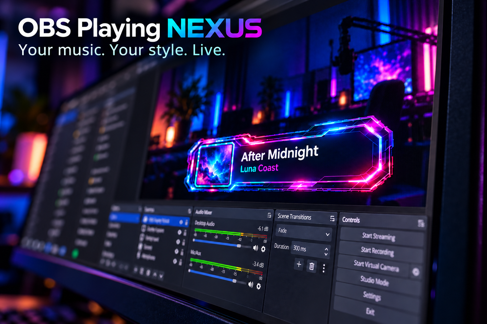
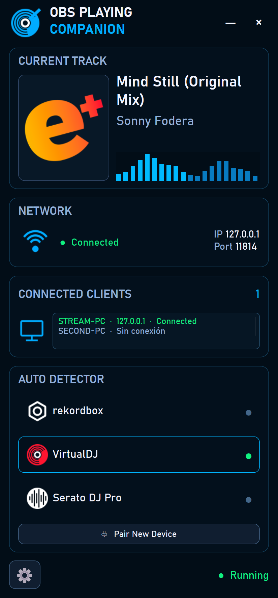

# OBS Playing NEXUS 1.0.0

Plugin nativo para OBS Studio y Companion para Windows x64 que muestran información de reproducción DJ. El Companion permite enviar texto y portadas al PC de streaming mediante TLS. **1.0.0 es la versión oficial estable indicada por el autor.**

Incluye 23 diseños originales. La compatibilidad depende de la versión y del estado de VirtualDJ, rekordbox o Serato; no implica medición del audio que sale de una mesa externa.

## Novedades de 1.0.0

- Traktor Pro 3 / 4 integrado en OBS y Companion: título, artista y portada, con validación de estructuras. Pruebas reales en 3.5.0 build 270 y 4.4.1 build 22.
- Companion compacto de 440 × 640, con desplazamiento y acceso a configuración/conexión en ventanas pequeñas.
- El panel principal muestra solo conexiones autenticadas actuales. Los PCs guardados permanecen en configuración; selección y revocación por ID.
- Cinco idiomas, panel único y anuncios opcionales de Twitch, desactivados por defecto.
- Identidades, escenas, perfiles, presets y los 23 diseños originales conservados.

Traktor MASTER representa el maestro de tempo, no una medición del audio audible. Las familias 3.x/4.x se admiten bajo validación de estructura; no se ha probado cada versión. El logo Traktor conserva su atribución de tercero.

## Preview

*Promotional illustration of a now-playing overlay in OBS.*

*Companion screenshot with demonstration data and a local loopback connection.*

## Instalación

Descarga el [instalador oficial 1.0.0](https://github.com/Emidj/obs-playing-nexus/releases/tag/v1.0.0). Cierra OBS y el Companion antes de actualizar. Selecciona Plugin OBS en el PC de streaming y Companion en el PC DJ. El plugin puede solicitar permisos de administrador para Program Files. Para portadas entre PCs, actualiza ambos componentes a 1.0.0.

Lee la [guía ilustrada en español](playing-next/docs/companion/README.md) o la [English guide](playing-next/docs/companion/README.en.md). El instalador incluye desinstalación y conserva backups de versiones reemplazadas.

El instalador no tiene firma digital. Compara SHA256 con el manifiesto de la Release.

## Código y compilación

Consulta [REBUILD.txt](REBUILD.txt), [documentación técnica](playing-next/README.md) y [estado de preparación](PUBLICATION-AUDIT.md). Se requieren Windows x64, Visual Studio 2022 C++, CMake 3.28 o superior y SDK Qt/OBS compatibles. Las recetas existentes contienen rutas del entorno original; todavía no está verificada una compilación desde Windows limpio.

Las fuentes correspondientes de 1.0.0 incluyen el motor compartido en `shared/`, fuentes Qt, recetas, parches y SBOM. Los archivos Qt originales se distribuyen junto al instalador en el ZIP Sources; no deben omitirse de la Release por estar excluidos del historial Git.

## Licencias

Este es un proyecto con varias licencias. [LICENSE](LICENSE) conserva la licencia MIT del código propio; **no licencia todo el plugin combinado como MIT**. El plugin combinado se distribuye bajo GPLv3, eligiendo la opción de versión posterior del motor GPL-2.0-or-later. Qt y otros terceros conservan sus licencias. Lee [LICENSES.md](LICENSES.md) y [COPYING](COPYING) antes de redistribuir binarios.

## Estado de validación

El informe final registra 49/49 suites, 69 checks del instalador, 60 del paquete Companion y dos suites UI/dispositivos repetidas al 150 %. La DLL final carga y cierra en OBS portable 32.2.2, con 23 fuentes originales y sin exports de prueba. Son resultados de desarrollo, no nuevos ensayos de publicación. Se verifican hashes, catálogo de idiomas y fuentes/licencias.

La instalación en otro PC y compatibilidad OBS constan como aceptación comunicada por el usuario, no como una nueva matriz ejecutada durante esta publicación. Siguen como seguimiento el chat real de Twitch, benchmark nuevo y Traktor entre dos PCs físicos. No se certifican todas las versiones Traktor ni compilación reproducible desde Windows limpio.

a plugin from [DjEmiMas](https://discord.gg/dhcqZPDYh)
