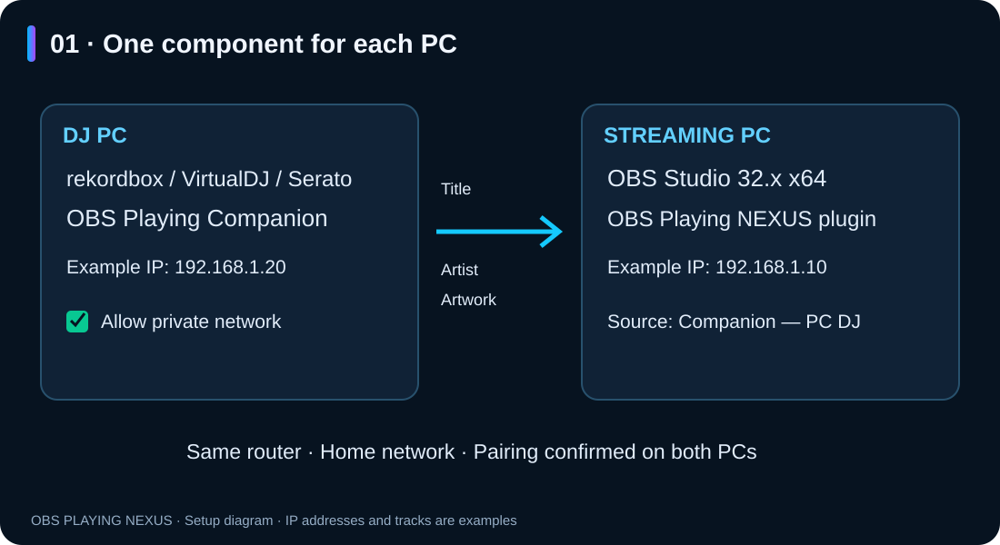
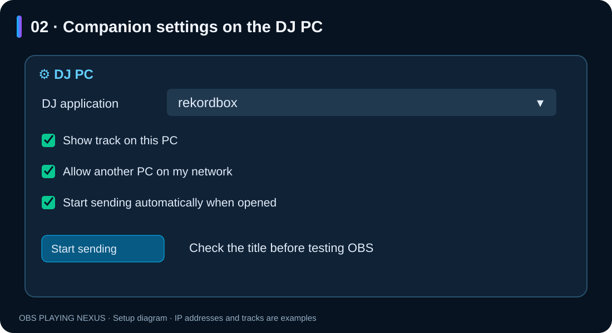
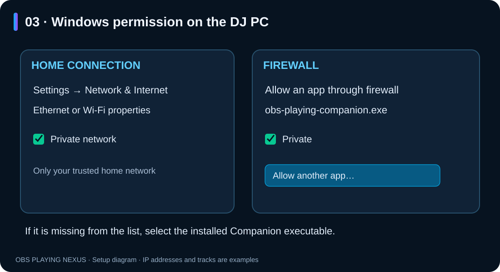
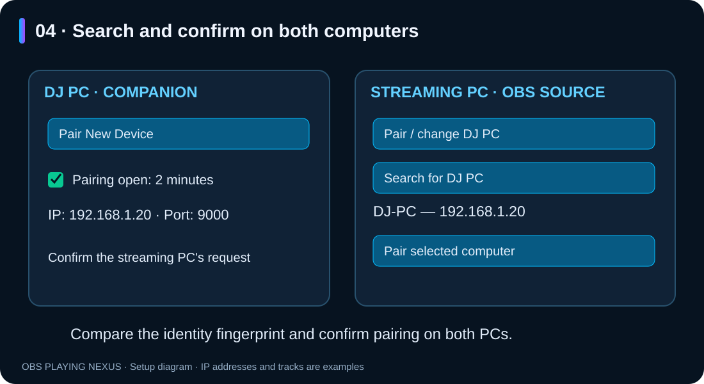
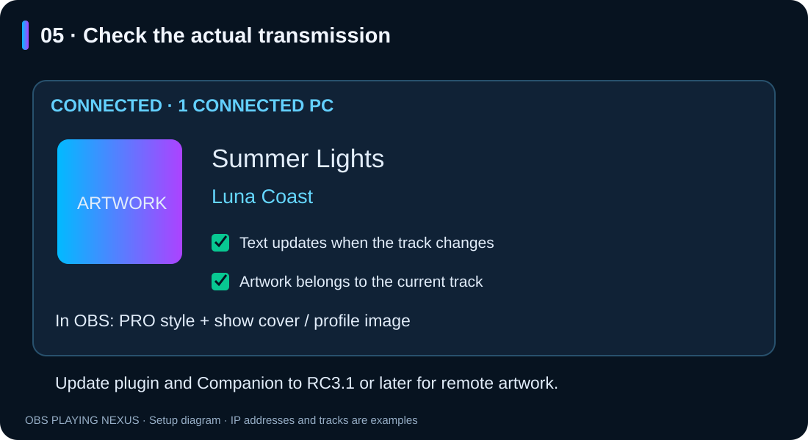

# OBS Playing NEXUS — Companion setup for two PCs

**Illustrated guide · Windows · RC3.1**

[Español](README.md) · **English**

Double-click **README.en.html** to open this illustrated guide in your browser,
even without an Internet connection. Keep the `imagenes` folder beside the README.

**Control names:** this RC displays several controls in Spanish. This guide gives
their exact labels with English explanations. The numbered diagrams use English
descriptions; they are illustrations, not screenshots of an English interface.

## 1. Install the right component on each computer

- **DJ PC:** your DJ application and **OBS Playing Companion**.
- **Streaming PC:** **OBS Studio 32.x x64** and the **OBS Playing NEXUS plugin**.
- Both computers must share your home network. Avoid a guest network or a VPN
  that changes the route between them during setup.
- For remote cover artwork, update **both components to RC3.1 or later**.



The same installer provides both options. Select **PC DJ · Companion** on the
DJ computer and **PC streaming · Plugin OBS** on the streaming computer.
Companion creates a desktop shortcut. Windows asks for administrator approval
when the plugin installation requires it. Close the relevant application before
updating it.

## 2. Check the DJ application's track information first

On the DJ PC:

1. Open Companion from the desktop and start your DJ application.
2. Click **⚙ Configuración y dispositivos** (settings and devices), then **PC DJ**.
3. Under **Programa DJ** (DJ application), select **rekordbox**, **VirtualDJ** or
   **Serato**. **Detectar automáticamente** enables automatic detection; select
   a specific application if several are playing at the same time.
4. Enable **Ver canción en este PC** (show track on this PC) and play a track.
5. Check that its **title and artist** appear under CURRENT TRACK.



**Ver canción en este PC** lets you check detection before a receiver connects.
Without a receiver or local preview, the detector can remain inactive. A waiting
message in that state does not by itself indicate a fault.

For Serato 4.0.10, enable the OBS Playing device under **Setup → Expansion Packs
→ External Control**. Automatic Rekordbox reading depends on its version and
playback mode. History modes are separate alternatives and may update later.


*Example screenshot from the local test setup, using VirtualDJ and fictional
track data. The address 127.0.0.1 shown here is for a single computer. For two
PCs, use the DJ PC's actual local address, as explained below.*

## 3. Allow network access in Windows

On your **trusted home network**, check that the connection on each PC is marked
**Private** under **Settings → Network & Internet → Ethernet or Wi-Fi connection
properties**.

On the DJ PC:

1. Open **Windows Security → Firewall & network protection**.
2. Select **Allow an app through firewall → Change settings**.
3. Find **OBS Playing Companion** or `obs-playing-companion.exe` and allow it
   on **Private** networks.
4. If it is missing, choose **Allow another app → Browse** and select the
   installed executable. The default location is:

```text
%LOCALAPPDATA%\OBS NEXUS\OBS Playing Companion\obs-playing-companion.exe
```



The Private permission only applies when that PC's connection is also classified
as Private. Windows handles administrator approval. This installer version does
not create firewall rules automatically.

See Microsoft's [instructions for allowing an application](https://support.microsoft.com/en-us/windows/security/firewall/risks-of-allowing-apps-through-windows-firewall)
and [explanation of firewall and network profiles](https://support.microsoft.com/en-us/windows/security/windows-security/firewall-and-network-protection-in-the-windows-security-app).

## 4. Open pairing on the DJ PC

1. Click **Pair New Device** on Companion's main screen.
2. If there are several network connections, select the one sharing a router
   with the streaming PC.
3. Pairing stays open for **two minutes**. Keep Companion open.
4. Under NETWORK, note its **local IP address** and **port**, normally **9000**.
   Example: `192.168.1.20` and `9000`. Each computer has its own address.

This button prepares sending and pairing over your local network. If configuring
it manually, enable **Permitir conexión desde otro PC de mi red** (allow another
PC on my network) and click **Iniciar envío** (start sending). The advertised
address must be the DJ PC's actual local IP address.

## 5. Pair from OBS on the streaming PC

1. Add an **OBS Playing NEXUS** source or open its properties.
2. Under **Programa DJ**, select **Companion — PC DJ**.
3. Disable **Tema de prueba (ficticio)** (fictional test track) for this check.
4. Click **Vincular / cambiar PC DJ → Buscar PC DJ** (pair/change DJ PC → search).
5. Select the other computer and click **Vincular equipo seleccionado**
   (pair selected computer).
6. Compare the displayed identity fingerprint and confirm the request **on both PCs**.



Pairing saves the destination for reconnection. You do not need to copy a code
for this procedure. If the two-minute window expires, click **Pair New Device**
again and repeat the search.

## 6. Check the title, artist and cover artwork

1. Companion should show **Connected** and at least **1 connected PC**.
2. OBS should show the same title and artist as the DJ PC.
3. Switch to another track and check that OBS updates.
4. To check artwork, select a **PRO** style, enable **Mostrar portada / imagen
   de perfil** (show cover/profile image) and play a track with available artwork.
5. Artwork may arrive after the text. RC3.1 sends it when available and associates
   it with the correct track.



When no cover is available, the Twitch profile image is used if that fallback is
enabled and your account is connected in OBS. Classic styles do not display
artwork. Companion transmits track data and artwork; it does not send the audio.

## 7. Startup, reconnection and changing computers

- On the DJ PC, enable **Iniciar envío automáticamente al abrir** (start sending
  automatically when opened) to avoid clicking Start sending every time.
- This takes effect **when Companion opens**; it does not configure Windows startup.
- The OBS source uses the saved pairing and attempts to recover an interrupted
  connection. The DJ PC's identity must still match.
- To change computers, use **Vincular / cambiar PC DJ**. Remove the local pairing
  with **Olvidar vinculación anterior** (forget previous pairing).
- In Companion on the DJ PC, **Revocar vinculación seleccionada** (revoke selected
  pairing) removes the previous computer's access. Forgetting a local destination
  does not itself revoke access on the remote DJ PC.
- If the DJ PC's IP address changes, search for it and pair again.

## 8. Troubleshooting

| Symptom | What to check |
|---|---|
| No title in Companion | Select the DJ application, enable «Ver canción en este PC» and play a track. Check its version and read permissions too. |
| OBS cannot find the DJ PC | Reopen the two-minute pairing window. Check the shared network, advertised IP, Private network profile and Companion firewall permission. |
| Companion is missing from the firewall list | Add its installed executable using «Allow another app». |
| The PC appears but pairing fails | Compare the identity and confirm on both computers before pairing expires. |
| OBS reports no linked profile | Complete «Vincular / cambiar PC DJ» from that OBS source. |
| Several DJ applications are playing | Select the intended application explicitly in Companion. |
| Text works but remote artwork is missing | Update both plugin and Companion to RC3.1 or later. Check artwork on the DJ PC and the artwork options in a PRO style. |
| A sample track is always displayed | Disable «Tema de prueba (ficticio)» in OBS. |
| Connection fails after changing networks | Check the current IP and search again. Check VPN and guest network settings. |

When requesting help, provide Windows/DJ application versions, the local IP and
port, and the visible message. **Do not share pairing codes, `.pcs` profile files,
passwords or credentials.**

*The numbered illustrations explain the setup steps. The dashboard image is an
actual screenshot with test data. OBS Playing NEXUS Companion setup guide.*
