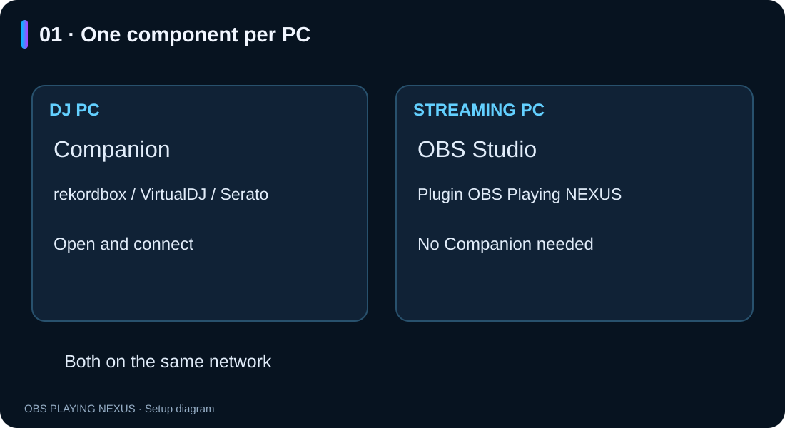
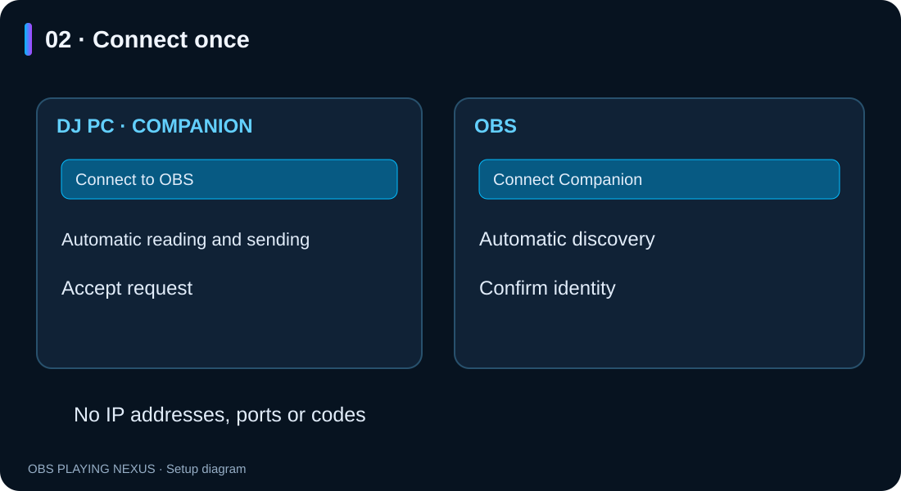
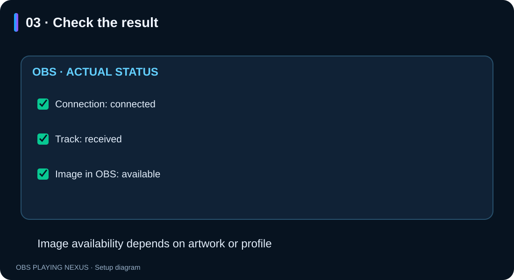

# OBS Playing NEXUS — connect your two PCs

**Illustrated guide · Windows · RC3.6**

[Español](README.md) · **English**

Double-click **README.en.html** to read the illustrated guide offline.
Keep the `imagenes` folder beside the document.

## 1. Install on each PC

- **DJ PC:** install **Companion** and open your DJ application.
- **Streaming PC:** install the **OBS Playing NEXUS plugin** and open OBS Studio 32.x x64.
- Companion is only needed on the DJ PC.
- Both computers must be on the same home network.
- Update both components to **RC3.4** to use this assistant.

The same installer offers a component for each computer. Companion creates a
desktop shortcut. Close the corresponding application before updating; Windows
may request administrator permission.



## 2. Connect for the first time

1. On the **DJ PC**, open Companion and press **Connect to OBS**. Keep this window open.
2. On the **streaming PC**, add an **OBS Playing NEXUS** source and press **Connect Companion** in its properties. Disable the fictional test track if enabled.
3. OBS searches automatically. If it finds only one DJ PC, it selects it. Check that its identity matches the one shown in Companion, tick the confirmation and press **Connect this PC**.
4. Accept the request in Companion. The OBS window shows the actual connection, track and image status.

There are no codes to copy or IP addresses and ports to enter. Companion has
no streaming-PC mode to select. The OBS button automatically switches the
source to the paired DJ PC.



The assistant automatically enables local track reading and sending on launch.
These are already enabled when opening a new Companion installation. You do not
need to tick «Ver canción en este PC» or «Iniciar envío automáticamente» to connect.
If multiple DJ applications are playing, select the one you want in the same window.

If Windows requests network permission, confirm it in Windows. Pairing stays
open for two minutes. If it expires, press **Retry connection setup** in Companion
and **Search again** in OBS. Closing the DJ assistant closes the pairing window;
already connected computers keep working.

## 3. Daily use and checks

Open Companion on the DJ PC and OBS on the streaming PC. Pairing is saved and
the active source automatically tries to reconnect. Automatic startup applies
when opening Companion; it does not configure Windows startup. Stop remains
available to stop sending during the current session.

Play music and change tracks. The OBS assistant separately reports the actual
**connection**, **received track** and **available image**. A connection can work
even when there is no music or artwork yet.



Choose a **PRO** style and enable the artwork/profile-image option to display
artwork. When artwork is unavailable, you can enable the Twitch profile fallback
with your Twitch account connected in OBS. Classic styles have no artwork.
Companion sends metadata and images, not audio.

## 4. Serato

Enable the OBS Playing device in **Setup → Expansion Packs → External Control**
inside Serato. This permission must be confirmed in Serato.
If the device is missing, check that **Bonjour Service** is installed and running
on the DJ PC (**Servizi → In esecuzione** in Italian Windows). Companion shows a
message when Bonjour is missing or does not respond.

## 5. Replace or remove a paired PC

In OBS press **Connect Companion → Change DJ PC** and follow the same assistant.
**Advanced options → Forget previous pairing** removes the saved destination
and stops its connection. To withdraw access from an old streaming PC, use
**Revoke selected pairing** in Companion settings on the DJ PC.
Forgetting the destination in OBS does not revoke its permission on the DJ PC.

## 6. Troubleshooting

| Problem | Check |
|---|---|
| OBS cannot find Companion | Same network, Companion running and «Connect to OBS» open. Avoid guest networks and VPN routes between the PCs. |
| Windows blocks the connection | On your trusted private home network, allow `obs-playing-companion.exe` through Firewall → Allow an app → Private. The installer does not add firewall rules. |
| No track in Companion | Play music and select the DJ application in the assistant if automatic detection is ambiguous. For Serato, check External Control and Bonjour. |
| Connected but no track | Check the track in Companion first; this does not necessarily mean a network failure. |
| Track arrives but no image | Check artwork in Companion and the image options of a PRO style in OBS. |
| A sample song stays visible | Disable the fictional test track in OBS. |
| An IP change prevents reconnection | Press «Change DJ PC» and search again. |

Default Companion path for the firewall permission:

```text
%LOCALAPPDATA%\OBS NEXUS\OBS Playing Companion\obs-playing-companion.exe
```

## 7. If an image is missing

The Connect Companion assistant distinguishes connection, track and image
availability. To use your Twitch profile, check the three image options at the
top and that your account is connected in OBS. After reconnecting Twitch,
close and reopen OBS to refresh the lookup.

If Companion also lacks artwork, check whether the image is embedded in the
local file and its format. A thumbnail in Serato does not prove the reader can
access it; this release does not certify artwork from streaming services.

When requesting help, provide versions and the visible message. **Never share
pairing codes, `.pcs` profiles, passwords or credentials.**

*The illustrations are assistant diagrams, not captures of a physical two-PC test.*

## Interface languages

Spanish, English, Italian, French and German are included. The plugin follows
the OBS language; Companion and the installer follow Windows. Other languages
use English. Style names, your presets and music metadata remain unchanged.

## Single settings panel

RC3.6 uses one editor, without a Basic/Advanced/Layout selector. Connection and
artwork options are first, followed by DJ application/reading, category/style,
light and motion, text and alignment. Track test controls are at the bottom.
Controls outside these blocks are hidden; saved values and older presets remain.
