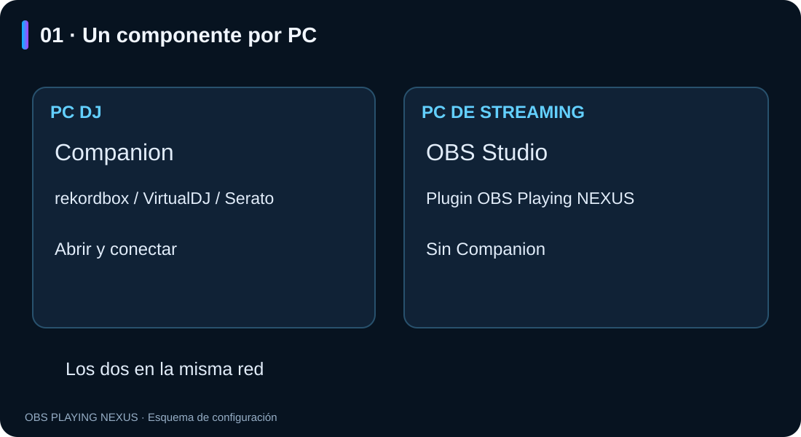
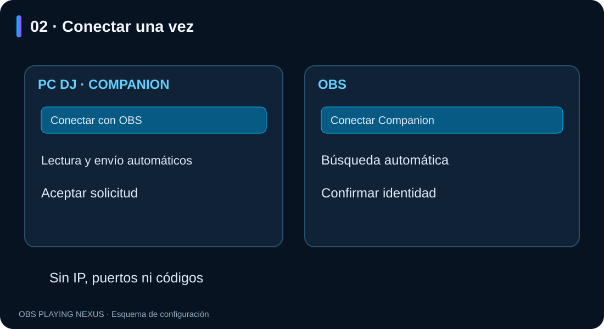
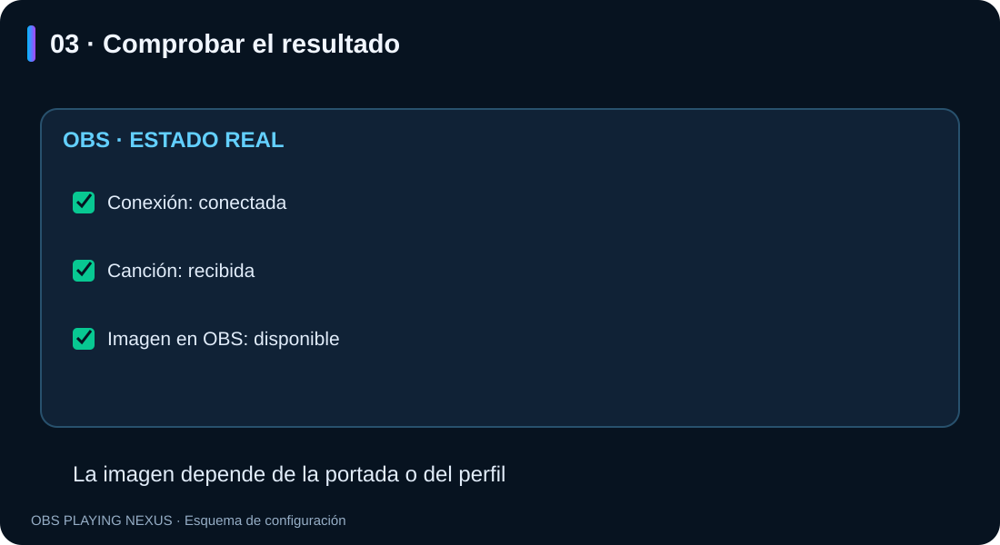

# OBS Playing NEXUS — conectar tus dos PCs

**Guía ilustrada · Windows · RC3.6**

**Español** · [English](README.en.md)

Abre **README.html** con doble clic para leer la guía offline con imágenes.
Conserva la carpeta `imagenes` junto al documento.

## 1. Instalar en cada PC

- **PC DJ:** instala **Companion** y abre tu programa DJ.
- **PC de streaming:** instala el **plugin OBS Playing NEXUS** y abre OBS Studio 32.x x64.
- No necesitas instalar Companion en el PC de streaming.
- Los dos equipos deben estar en la misma red doméstica.
- Actualiza ambos componentes a **RC3.4** para seguir este asistente.

El mismo instalador permite elegir el componente para cada equipo. Companion
crea un acceso directo en el escritorio. Cierra la aplicación correspondiente
antes de actualizar; Windows puede solicitar permisos de administrador.



## 2. Conectar por primera vez

1. En el **PC DJ**, abre Companion y pulsa **Conectar con OBS**. Deja abierta esa ventana.
2. En el **PC de streaming**, añade una fuente **OBS Playing NEXUS** y pulsa **Conectar Companion** en sus propiedades. Desactiva el tema ficticio si estaba activo.
3. OBS busca el PC DJ automáticamente. Si solo encuentra uno, lo selecciona. Comprueba que la identidad coincide con la del Companion, marca la confirmación y pulsa **Conectar este PC**.
4. Acepta la solicitud en el Companion. La ventana de OBS mostrará la conexión real y si recibe canción e imagen.

No hay que copiar códigos, introducir IP o puerto, ni seleccionar un modo
«PC de streaming» en Companion. El botón de OBS cambia automáticamente la
fuente al PC DJ vinculado.



La lectura local y el inicio del envío se activan automáticamente en el asistente.
En instalaciones nuevas ya están activados al abrir Companion. No necesitas
marcar «Ver canción en este PC» o «Iniciar envío automáticamente» para conectarlo.
Si hay varios programas DJ reproduciendo, elige el que quieras en la misma ventana.

El permiso de red de Windows, si aparece, se confirma en Windows. La vinculación
queda abierta durante dos minutos; si caduca, pulsa **Volver a buscar conexión**
en Companion y **Buscar de nuevo** en OBS. Cerrar el asistente del PC DJ cierra
la ventana de vinculación; los equipos ya conectados siguen funcionando.

## 3. Uso diario y comprobación

Abre Companion en el PC DJ y OBS en el PC de streaming. La vinculación queda
guardada y la fuente intenta reconectarse automáticamente cuando está activa.
El inicio automático actúa al abrir Companion; no configura el inicio de Windows.
El botón de detener sigue permitiendo parar el envío durante la sesión.

Reproduce música y cambia de canción. La ventana de OBS distingue **conexión**,
**canción recibida** e **imagen disponible**. Una conexión puede funcionar aunque
todavía no haya música o portada.



Para ver una portada, elige un estilo **PRO** y activa **Mostrar portada / imagen
de perfil**. Si no hay portada, puedes usar el perfil de Twitch con la cuenta
conectada en OBS y la alternativa de perfil activada. Los clásicos no llevan portada.
Companion envía datos e imagen; no envía el audio.

## 4. Serato

En Serato, activa el dispositivo de OBS Playing en **Setup → Expansion Packs →
External Control**. Este permiso pertenece a Serato y se confirma allí.
Si el dispositivo no aparece, comprueba que **Bonjour Service** esté instalado
y en ejecución en el PC DJ (**Servizi → In esecuzione** en Windows italiano).
El panel de Companion indica si Bonjour falta o no responde.

## 5. Cambiar de PC o retirar una vinculación

En OBS, pulsa **Conectar Companion → Cambiar PC DJ** y sigue el mismo asistente.
En **Opciones avanzadas → Olvidar vinculación anterior** puedes retirar el destino
guardado y detener su conexión. Para quitar el permiso al PC anterior, usa
**Revocar vinculación seleccionada** en los ajustes del Companion del PC DJ.
Olvidar el destino en OBS no revoca el permiso guardado en el PC DJ.

## 6. Si algo falla

| Qué ocurre | Qué comprobar |
|---|---|
| OBS no encuentra Companion | Misma red, Companion abierto y «Conectar con OBS» abierto. Evita red de invitados o VPN entre los equipos. |
| Windows bloquea la conexión | En tu red doméstica privada, permite `obs-playing-companion.exe` en Firewall → Permitir una aplicación → Privada. El instalador no crea reglas de firewall. |
| Companion no muestra canción | Reproduce música y selecciona el programa DJ en el asistente si la detección automática es ambigua. En Serato revisa External Control y Bonjour. |
| Hay conexión pero no canción | Revisa primero la canción en Companion; no es necesariamente un fallo de red. |
| Hay canción pero no imagen | Comprueba la portada en Companion y las opciones de imagen de un estilo PRO. |
| Se ve una canción de ejemplo | Desactiva «Tema de prueba (ficticio)» en OBS. |
| Cambia la IP y no reconecta | Pulsa «Cambiar PC DJ» y vuelve a buscarlo. |

Ruta habitual del Companion para el permiso del firewall:

```text
%LOCALAPPDATA%\OBS NEXUS\OBS Playing Companion\obs-playing-companion.exe
```

## 7. Si falta una imagen

El asistente «Conectar Companion» distingue conexión, canción e imagen disponible.
Para usar el perfil de Twitch, comprueba las tres opciones de imagen del bloque
superior y que tu cuenta esté conectada en OBS. Si has vuelto a conectar Twitch,
cierra y abre OBS para renovar la consulta.

Si tampoco hay portada en Companion, comprueba si está incrustada en el archivo
local y su formato. Ver una miniatura en Serato no demuestra que el lector pueda
obtenerla; esta versión no certifica portadas de servicios de streaming.

Para pedir ayuda, indica versiones y el mensaje visible. **No compartas códigos,
perfiles `.pcs`, contraseñas ni credenciales.**

*Las imágenes son esquemas del asistente, no capturas de una prueba entre dos PCs físicos.*

## Idiomas de la interfaz

Español, inglés, italiano, francés y alemán incluidos. El plugin sigue el idioma
de OBS; Companion y el instalador siguen Windows. Otros idiomas usan inglés.
Los nombres de estilos, tus presets y los datos musicales se conservan.

## Panel único de ajustes

Desde RC3.6 hay un solo editor, sin selector Básico/Avanzado/Distribución.
Conexión y opciones de portada están arriba, seguidas de programa/lectura,
categoría/estilo, luz y movimiento, texto y alineación. Las pruebas de canción
quedan al final. Los controles ajenos a estos bloques ya no se muestran;
los valores guardados y presets anteriores se conservan.
