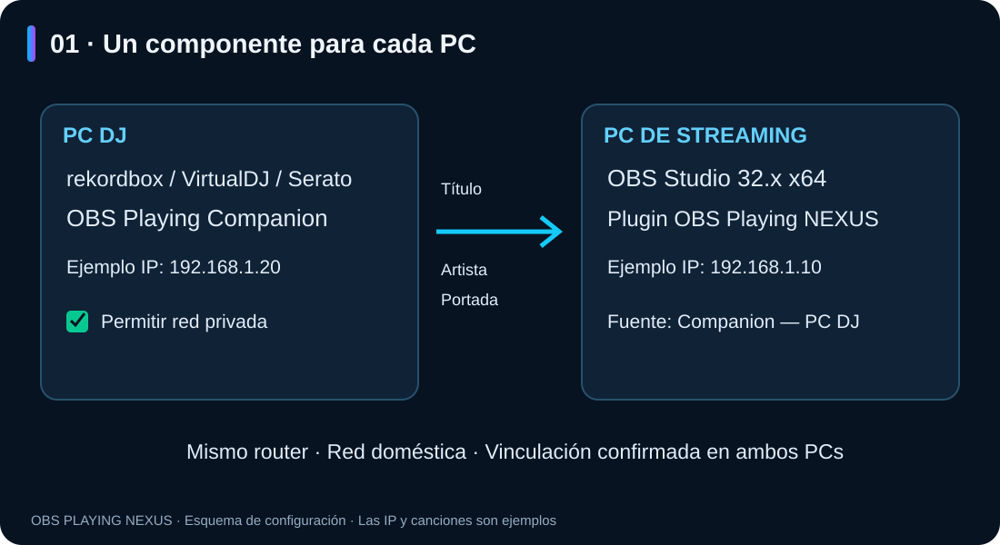
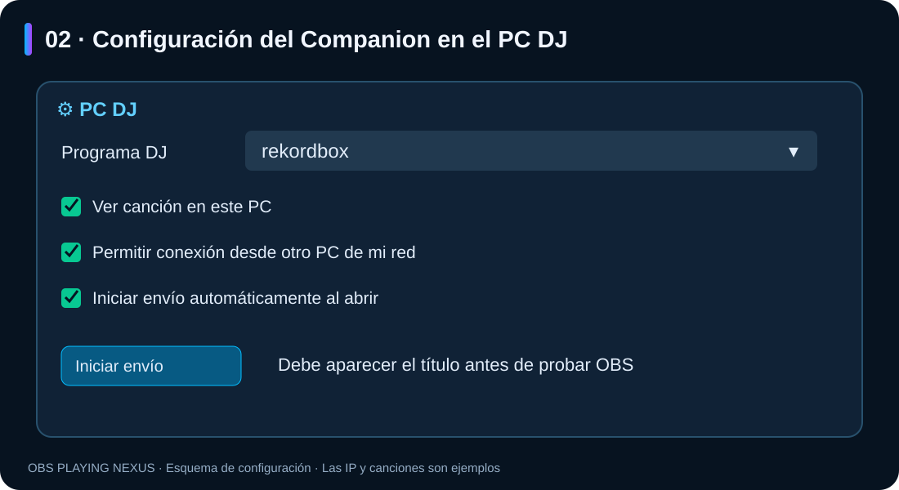
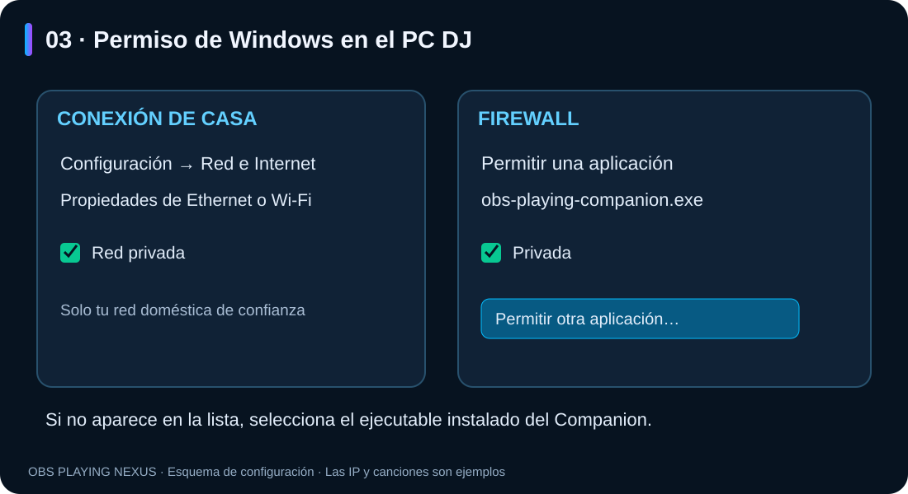
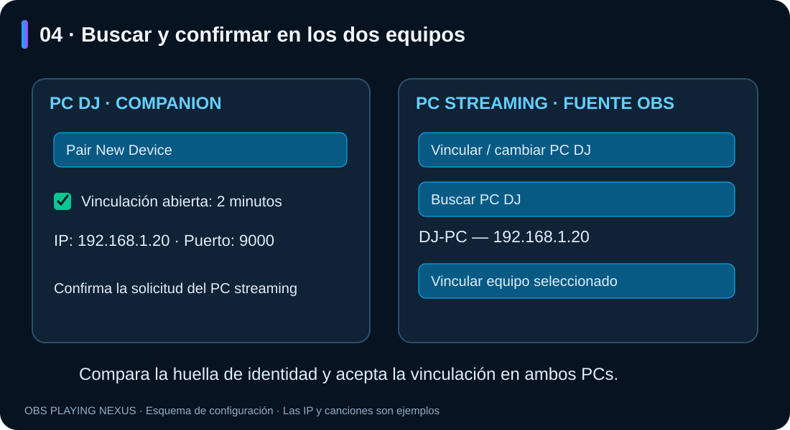
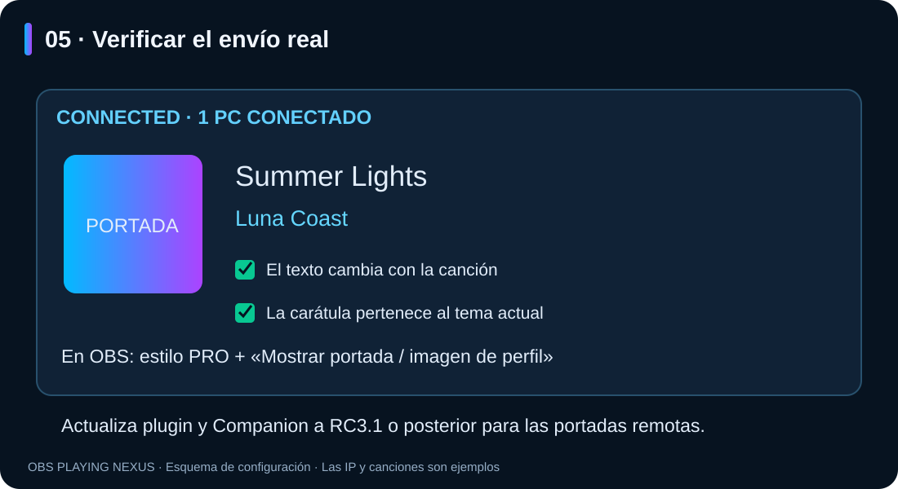

# OBS Playing NEXUS — configurar Companion entre dos PCs

**Guía ilustrada · Windows · RC3.2**

**Español** · [English](README.en.md)

Puedes abrir **README.html** con doble clic para leer esta guía con imágenes en
el navegador, sin conexión a Internet. Conserva la carpeta `imagenes` junto al README.

## 1. Qué se instala en cada ordenador

- **PC DJ:** tu programa DJ y **OBS Playing Companion**.
- **PC de streaming:** **OBS Studio 32.x x64** y el **plugin OBS Playing NEXUS**.
- Ambos PCs deben compartir tu red doméstica. Evita la red de invitados y una
  VPN que cambie la ruta entre estos equipos durante la configuración.
- Para usar las carátulas remotas, actualiza **ambos componentes a RC3.1 o posterior**.



El mismo instalador ofrece las dos opciones: elige **PC DJ · Companion** en el
ordenador DJ y **PC streaming · Plugin OBS** en el ordenador de emisión.
El Companion crea un acceso directo en el escritorio. El instalador solicita
la confirmación de administrador de Windows cuando la instalación del plugin
lo requiere. Cierra la aplicación correspondiente antes de actualizarla.

## 2. Comprobar primero la lectura del programa DJ

En el PC DJ:

1. Abre el Companion desde el escritorio y tu programa DJ.
2. Pulsa **⚙ Configuración y dispositivos** y entra en **PC DJ**.
3. En **Programa DJ**, selecciona **rekordbox**, **VirtualDJ** o **Serato**.
   «Detectar automáticamente» también está disponible; selecciona uno si hay
   varios programas reproduciendo simultáneamente.
4. Activa **Ver canción en este PC** y reproduce una canción.
5. Comprueba que aparecen **título y artista** en CURRENT TRACK.



**Ver canción en este PC** permite comprobar la lectura aunque todavía no haya
ningún receptor conectado. Si no hay un receptor ni vista local, el detector
puede permanecer inactivo. «Esperando canción» en ese estado no demuestra un fallo.

En Serato 4.0.10, activa el dispositivo de OBS Playing en **Setup → Expansion
Packs → External Control**. La lectura automática de Rekordbox depende de la
versión y del modo de reproducción; los modos de historial son alternativas
distintas y pueden actualizarse más tarde.

Si el dispositivo no aparece en External Control, comprueba en **Servicios**
(**Servizi** en Windows italiano) que **Bonjour Service** esté instalado y
**En ejecución / In esecuzione**. El Companion necesita Bonjour en el PC DJ
para anunciarse a Serato; tener ambos PCs vinculados no sustituye este servicio.
Desde RC3.2, la selección del programa se aplica inmediatamente y el panel
muestra un aviso si Bonjour no está disponible o no responde.

La ventana del Companion es compacta y se adapta al espacio disponible y al
escalado de Windows. Puedes cambiar su tamaño desde la esquina inferior derecha;
si falta altura, desplaza el contenido con la rueda o la barra lateral. El botón
de configuración permanece accesible y la ventana de ajustes también permite
el desplazamiento.


*Captura de ejemplo del banco local, con VirtualDJ y datos ficticios. La IP
127.0.0.1 que aparece en esta captura sirve para un solo ordenador; para dos PCs
debes utilizar la dirección local real del PC DJ, como explica el siguiente paso.*

## 3. Dar permiso de red en Windows

En tu **red doméstica de confianza**, comprueba en cada PC que la conexión está
marcada como **Privada** en **Configuración → Red e Internet → propiedades de la
conexión Ethernet o Wi-Fi**.

En el PC DJ:

1. Abre **Seguridad de Windows → Firewall y protección de red**.
2. Entra en **Permitir una aplicación a través del firewall → Cambiar configuración**.
3. Busca **OBS Playing Companion** o `obs-playing-companion.exe` y permite la
   aplicación en **Privada**.
4. Si no aparece, pulsa **Permitir otra aplicación → Examinar** y selecciona
   el ejecutable instalado. La ruta predeterminada es:

```text
%LOCALAPPDATA%\OBS NEXUS\OBS Playing Companion\obs-playing-companion.exe
```



El permiso «Privada» solo se aplica si la conexión de ese PC también está
clasificada como privada. La confirmación de administrador pertenece a Windows.
El instalador de esta versión no crea reglas de firewall automáticamente.

Consulta las [instrucciones oficiales de Microsoft para permitir una aplicación](https://support.microsoft.com/es-es/windows/security/firewall/risks-of-allowing-apps-through-windows-firewall)
y la [explicación de redes privadas y públicas](https://support.microsoft.com/es-es/windows/security/windows-security/firewall-and-network-protection-in-the-windows-security-app).

## 4. Permitir la vinculación desde el PC DJ

1. Pulsa **Pair New Device** en la pantalla principal del Companion.
2. Si hay varias conexiones de red, elige la que comparte router con el PC de streaming.
3. La vinculación queda abierta durante **dos minutos**. Mantén el Companion abierto.
4. En NETWORK, anota su **IP local** y su **puerto**, normalmente **9000**.
   Ejemplo: `192.168.1.20` y `9000`. Cada equipo tiene su propia dirección.

Este botón prepara el envío y la vinculación por la red local. Si haces los
ajustes manualmente, activa **Permitir conexión desde otro PC de mi red** y pulsa
**Iniciar envío**. La dirección anunciada debe ser la IP real del PC DJ.

## 5. Vincular desde OBS en el PC de streaming

1. Añade o abre las propiedades de una fuente **OBS Playing NEXUS**.
2. En **Programa DJ**, selecciona **Companion — PC DJ**.
3. Desactiva **Tema de prueba (ficticio)** durante esta comprobación.
4. Pulsa **Vincular / cambiar PC DJ → Buscar PC DJ**.
5. Selecciona el nombre del otro equipo y pulsa **Vincular equipo seleccionado**.
6. Compara la huella de identidad mostrada y confirma la solicitud **en ambos PCs**.



La vinculación guarda el destino y permite reconectar. No hace falta copiar
códigos para este procedimiento. Si caducan los dos minutos, vuelve a pulsar
**Pair New Device** y repite la búsqueda.

## 6. Verificar título, artista y carátula

1. El Companion debe mostrar **Connected** y al menos **1 PC conectado**.
2. OBS debe mostrar el mismo título y artista que el PC DJ.
3. Cambia a otra canción y comprueba que OBS se actualiza.
4. Para comprobar la carátula, elige un estilo **PRO**, activa **Mostrar portada /
   imagen de perfil** y reproduce una canción con portada disponible.
5. La portada puede aparecer después del texto. RC3.1 la envía cuando está
   disponible y la asocia a la canción correcta.



Si no hay portada, se utiliza la imagen de perfil de Twitch si tienes activada
esa alternativa y la cuenta conectada en OBS. Los estilos clásicos no llevan
portada. El Companion no envía la canción de audio: transmite sus datos y su imagen.

## 7. Inicio, reconexión y cambio de ordenador

- En el Companion del PC DJ, activa **Iniciar envío automáticamente al abrir**
  para no tener que pulsar «Iniciar envío» cada vez que abras la aplicación.
- Este ajuste actúa **al abrir el Companion**; no configura el inicio de Windows.
- La fuente de OBS utiliza la vinculación guardada e intenta recuperar una
  conexión interrumpida. La identidad del PC DJ debe seguir coincidiendo.
- Para cambiar de PC, usa **Vincular / cambiar PC DJ**. Puedes retirar la
  vinculación local con **Olvidar vinculación anterior**.
- En el Companion del PC DJ, **Revocar vinculación seleccionada** retira el
  acceso del equipo anterior. Olvidar un destino local no revoca por sí solo su acceso remoto.
- Si cambia la IP del PC DJ, vuelve a buscarlo y vincularlo.

## 8. Solución de problemas

| Síntoma | Comprobación |
|---|---|
| No aparece título en el Companion | Selecciona el programa, activa «Ver canción en este PC» y reproduce una canción. Comprueba también su versión y permisos de lectura. |
| OBS no encuentra el PC DJ | Abre de nuevo la ventana de dos minutos; revisa misma red, IP anunciada, red privada y permiso del Companion en el firewall. |
| El Companion no aparece en el firewall | Añade manualmente su ejecutable mediante «Permitir otra aplicación». |
| Aparece el PC pero falla al vincular | Compara la identidad y acepta la solicitud en los dos equipos antes de que caduque. |
| OBS indica que no hay perfil vinculado | Completa «Vincular / cambiar PC DJ» desde esa fuente de OBS. |
| Hay varios programas DJ reproduciendo | Selecciona expresamente el programa en el Companion. |
| Hay texto pero no carátula remota | Actualiza plugin y Companion a RC3.1 o posterior; comprueba la portada en el PC DJ y las opciones de portada de un estilo PRO. |
| Se ve siempre una canción de ejemplo | Desactiva «Tema de prueba (ficticio)» en OBS. |
| Se interrumpe al cambiar de red | Comprueba la IP actual y vuelve a buscar el PC DJ; revisa VPN y red de invitados. |

Para solicitar ayuda, indica versiones de Windows/programa DJ, IP y puerto
locales y el mensaje visible. **No compartas códigos de vinculación, archivos
de perfil `.pcs`, contraseñas ni credenciales.**

*Las ilustraciones numeradas son esquemas de los pasos. La imagen del dashboard
es una captura real con datos de prueba. Guía de configuración de OBS Playing NEXUS.*
